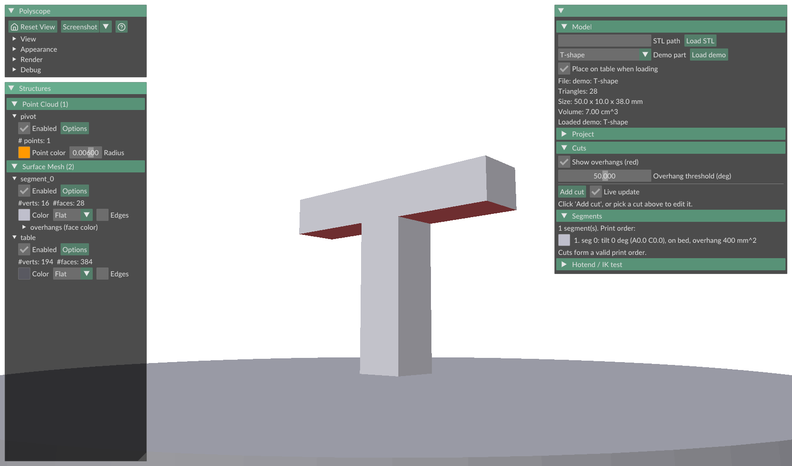
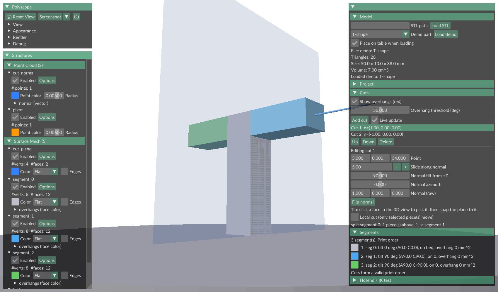
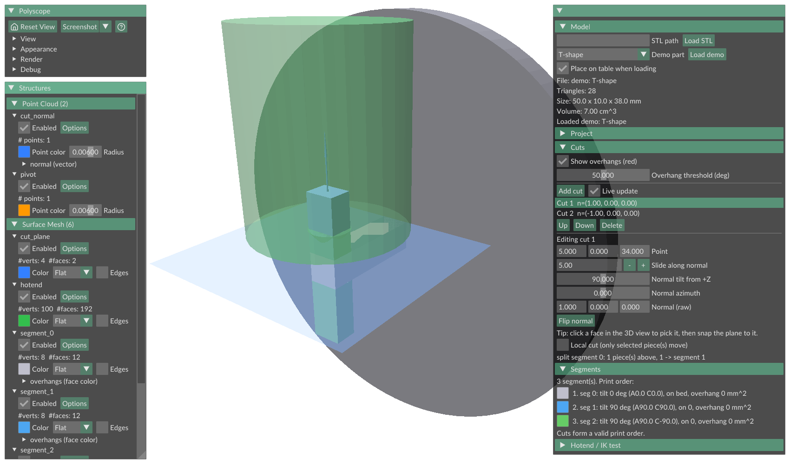

# segslicer: "3+2" segmented slicer for a DIY 5-axis FDM printer

**Status: Milestone 2 (manual segment editor).** The full README (pivot
calibration, tuning, first-print workflow) comes in Milestone 7.

| Overhangs flagged (red) | Cut into segments | Machine view of segment 1 |
|---|---|---|
|  |  |  |

## Setup

```bash
cd five_axis_slicer
python -m venv .venv
source .venv/bin/activate        # Windows: .venv\Scripts\activate
pip install -r requirements.txt
```

Python 3.11 or newer.

## Run

```bash
python -m segslicer                              # empty; pick a demo part in the panel
python -m segslicer path/to/model.stl
python -m segslicer examples/t_shape.json        # open a saved project
python -m segslicer --machine my_machine.yaml    # use a different machine file
```

You can also type a path into the **STL path** box and click **Load STL**, or
choose a built-in **Demo part** (cube, cube with arm, T-shape).

## Run the tests

```bash
python -m pytest
```

## Configure your machine

Edit `config/machine.yaml`. Every value marked **FILL IN** is a placeholder.
The most important ones are:

| Key | What it is |
|---|---|
| `kinematics.pivot` | Machine XYZ where the A and C axes cross |
| `kinematics.a_axis.sign` / `c_axis.sign` | `1` if a positive G-code angle turns the table by the right-hand rule, `-1` if the other way |
| `kinematics.*.min_deg/max_deg` | Rotary travel limits, in commanded degrees |
| `table.surface_z` | Machine Z of the table top at A = 0 |
| `hotend.*` | Collision envelope (cone at the tip and a cylinder above it) |

`config/settings.yaml` holds the PrusaSlicer path (used from Milestone 4).

## Code map

```
segslicer/
  config.py      machine.yaml / settings.yaml -> dataclasses, with validation
  transforms.py  rotations: direction -> +Z and back, rotate about a point
  kinematics.py  A/C inverse kinematics, part frame <-> machine XYZ
  collision.py   hotend cone + cylinder model, sampled-surface collision check
  mesh_io.py     STL loading, placing the part on the table
  geometry.py    plane cuts (manifold3d), unions, point-in-mesh, distances
  overhang.py    which faces are overhangs for a given build direction
  segments.py    cuts -> segments, local cuts, dependency / print order
  project.py     save / load projects as JSON
  demo_models.py cube, cube-with-arm, T-shape generated in code
  viewer.py      Polyscope window and ImGui panel
tests/           pytest unit tests
examples/        saved projects for the demo parts
```

### The kinematics in one picture

The part sits on the C table, and the C table sits on the A trunnion. So a
point `p` on the part (part frame = machine frame when A = C = 0) ends up at

```
machine = R_A(a) · R_C(c) · (p − pivot) + pivot
```

with `R_A` a rotation about X and `R_C` a rotation about Z. For a segment with
build direction `d`, the inverse kinematics (IK) finds `a` and `c` so that
`R_A R_C d = +Z`. That makes the segment's layers horizontal under the nozzle:

1. Turn C so `d` lies in the machine's YZ plane: `c = 90° − atan2(dy, dx)`.
2. Tilt A by the angle between `d` and vertical: `a = atan2(√(dx²+dy²), dz)`.

There is always a mirror solution (`a → −a`, `c → c − 180°`). The code tries
both, keeps those inside the axis limits, and picks the one with the smallest
C move from the previous pose.

### The collision check

Obstacle meshes (the table and segments already printed) are sampled into
surface points about `collision.sample_spacing` mm apart. For a given nozzle
tip and tool direction, the points are moved into the tool frame and tested
against the cone/cylinder envelope. The envelope is grown slightly so a
surface cannot slip between samples, which makes the check err on the safe
side. Points within `hotend.tip_ignore_height` of the tip along the axis are
ignored, so the surface being printed on does not count as a hit.

## Segments and cuts

A **cut** is a plane: a point and a normal. The normal is the **build
direction** of the new segment, which forms on the side the normal points to.
Segment 0 is what's left on the bed and prints straight up (+Z).

Cuts are applied in list order:

1. The cut only splits the segment that **contains its point**. A plane that
   also passes through other segments leaves them alone.
2. **Normal cut:** everything on the normal's side becomes the new segment.
3. **Local cut:** the normal's side can break into separate pieces (e.g. two
   posts sticking up). Only the selected piece(s) become the new segment
   (default: the piece nearest the cut point). The others stay with the
   segment that was cut.

Since each cut only sees the cuts before it, **Up/Down reorders and can change
the result**.

**Print order** is worked out from the geometry. Each segment's flat base face
(its "cap") rests on some other segment, and that segment must print first.
The app probes just below the cap to find out which one it is. The Segments
panel warns about:

- a cut point that isn't inside anything
- a plane that doesn't actually split its segment
- a piece that would print in mid-air
- a base that rests on nothing
- segments that depend on each other in a loop
- build directions beyond the A-axis limits

**Overhangs:** with build direction `d`, a face is an overhang when its normal
is within `90 - threshold` degrees of `-d` (default threshold 50, so faces
leaning more than 50 deg from vertical). Faces on a segment's own base are
ignored.

### Editing a cut

- **Point / Slide along normal** move the plane.
- **Normal tilt / azimuth** (or the raw vector) set the build direction.
- **Click a face** in the 3D view to pick it. Then use **Normal <- picked
  face**, **Point <- picked point**, or both. Example: to print an arm
  sideways, pick the arm's end face to get the normal, then slide the plane
  back to where the arm meets the body.
- **Live update** re-cuts on every change. Turn it off for big meshes and use
  **Apply cuts** instead.
- **Project > Save/Load** stores the model path (relative to the project file)
  and the cuts as JSON.

## Milestone 2 manual test checklist

1. `python -m segslicer`, choose **T-shape** and click **Load demo**. The bar
   undersides are red.
2. **Add cut**. Set the point to `5, 0, 34` and the normal tilt/azimuth to
   90 / 0. The right half of the bar turns blue and loses its red.
3. Add a second cut at `-5, 0, 34` with azimuth 180. You now have 3 segments,
   print order 1-2-3, and no warnings.
4. Open **Hotend / IK test**, select cut 1, click **Aim at selected cut**,
   then tick **Machine view**. The blue segment stands upright under a
   vertical hotend.
5. Try a bad cut (normal pointing down, `tilt 180`) and read the warnings.
6. Save the project, load another demo, then load the project again.
7. Compare with `python -m segslicer examples/t_shape.json`.

## Milestone 1 manual test checklist

1. `python -m segslicer some_part.stl`: the part sits on the grey table,
   centred on the orange pivot point.
2. Open **Hotend / IK test** and tick **Show hotend**. The green hotend sits at
   the top centre of the part.
3. Drag **Tilt** to about 45° and change **Azimuth**. The A/C numbers update.
   When the hotend hits the part or table, it turns red and the panel names
   the obstacle.
4. Tick **Machine view**. The part and table rotate by A/C, and the hotend
   should always point straight down (vertical) at the tilted part.
5. Set Tilt above 90°. The panel should say the direction is unreachable.
